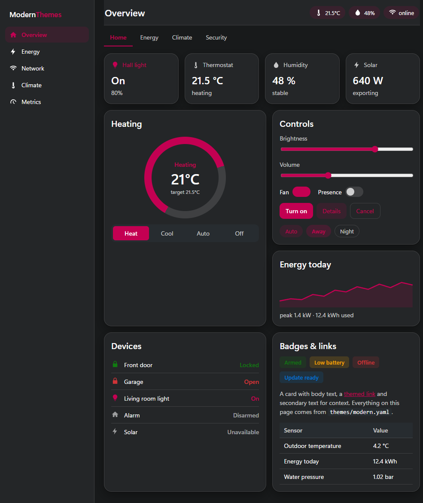
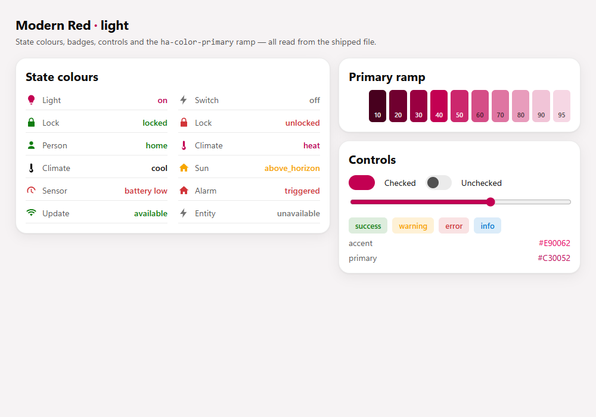
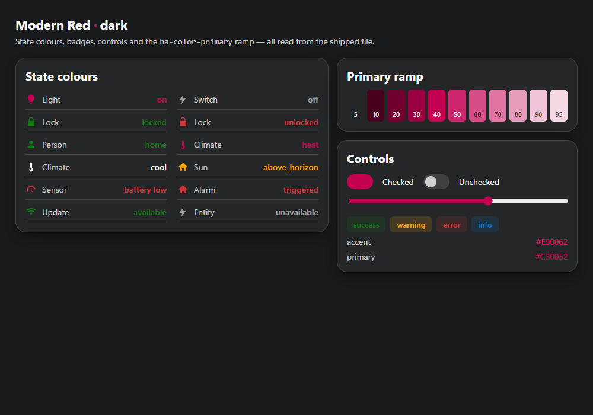

# Modern Themes for Home Assistant

A modern, native theme family for **Home Assistant** — eleven color variants,
each with a light and a dark mode, built entirely from Home Assistant's own theme
variables.

No `card-mod`. No shadow-DOM CSS patches. No custom frontend code. Just theme tokens,
so the themes keep working across Home Assistant updates.

> **Inspired by** [Metrology for Hass](https://github.com/Madelena/Metrology-for-Hass)
> by Madelena Mak, and by Microsoft's Fluent and Metro design languages.
> Modern Themes is an independent implementation written from scratch against Home
> Assistant 2026 theme variables. It does not contain or redistribute Metrology's code.

---

## Variants

<!-- BEGIN VARIANTS -->
| Theme | Primary | Accent | Text on primary |
| --- | --- | --- | --- |
| **Modern Red** (base) | `#C30052` | `#E90062` | white |
| **Modern Blue** | `#0078D7` | `#008DFD` | white |
| **Modern Green** | `#00CB6A` | `#00F17D` | black |
| **Modern Orange** | `#FF8C00` | `#FF9D00` | black |
| **Modern Purple** | `#6A00CB` | `#A94DFF` | white |
| **Modern Slate** | `#4F5A68` | `#677385` | white |
| **Modern Teal** | `#008272` | `#00B294` | white |
| **Modern Amber** | `#C77D00` | `#FFB900` | black |
| **Modern Indigo** | `#4B53BC` | `#6B73E8` | white |
| **Modern Pink** | `#C239B3` | `#E3008C` | white |
| **Modern Graphite** | `#5D5D5D` | `#8A8A8A` | white |
<!-- END VARIANTS -->

All variants share one design language; only the brand color, the generated
`--ha-color-primary-*` ramp and the tinted background surfaces change.

## What it styles

- **Brand ramp** — the full `--ha-color-primary-05 … --ha-color-primary-95` scale,
  derived from each variant's primary color.
- **Legacy tokens** — `paper-*`, `mdc-*` and Material variables, kept because
  third-party cards still read them (Mushroom and button-card are examples). The
  frontend itself no longer declares these names.
- **Surfaces** — primary/secondary/card backgrounds, dividers, outlines, dialogs,
  sidebar, top app bar, and the dashboard **edit-mode** app bar.
- **State colors** — active/inactive defaults plus domain-specific mapping for
  climate (`heat`, `cool`, `heat_cool`, `auto`, `dry`, `fan_only`, `off`),
  water heater (`eco`, `electric`, `gas`, `heat_pump`, `high_demand`, `performance`),
  alarm control panel, lock, battery, media player, person, plant, siren, update,
  sun, vacuum, valve, fan, cover, lawn mower and more.
- **Typography** — `--ha-font-family-*` set to Segoe UI Variable with system fallbacks,
  plus `paper-font-*` and `mdc-typography-*` aliases.
- **Geometry and elevation** — `--ha-border-radius-*`, `--ha-box-shadow-*`,
  `--ha-picture-border-radius`, `--wa-panel-border-radius`.
- **Forms** — input fill, ink, outline and hover colors in both modes.
- **Badges** — `label-badge-*` colors that follow the variant.
- **Light and dark** — every variant ships both, via `modes:`.

## Requirements

- Home Assistant **2025.8** or newer. The `--ha-color-*` token set this theme is
  built around first appears in the frontend shipped with 2025.8
  ([frontend 20250806.0](https://github.com/home-assistant/frontend/blob/20250806.0/src/resources/theme/color/core.globals.ts));
  the frontend used by 2025.7 does not define it.
- No integrations, no extra cards, no card-mod.

Older releases still load the theme — unknown variables are simply ignored — but the
newest components keep their default colors, so the look is incomplete rather than broken.

The native **Marketplace** only exists from Home Assistant 2026.11 onward
([component](https://github.com/home-assistant/core/tree/2026.11.2/homeassistant/components/marketplace));
on older releases install manually.

## Installation

### Marketplace (Home Assistant 2026.11+)

1. **Settings → Marketplace**
2. Menu → **Add from a GitHub link**
3. Paste `https://github.com/richka/ha-modern-themes`, choose type **Theme**
4. Install, then reload the page

Adding a custom repository needs a GitHub connection, which the dialog offers if you have
not connected one yet.

### Manual

Copy `themes/modern.yaml` to your configuration directory:

```
/config/themes/modern.yaml
```

Make sure themes are included in `configuration.yaml`:

```yaml
frontend:
  themes: !include_dir_merge_named themes
```

Any file below `themes/` works. The Marketplace puts the theme in
`themes/modern/modern.yaml`; copying it to `themes/modern.yaml` is equally fine.

Then reload:

- **Developer tools → Actions → `frontend.reload_themes`**, or
- restart Home Assistant.

Finally, hard-refresh the browser (`Ctrl + F5`) so the new CSS variables are picked up.

> ⚠️ Install the file **once**. Theme names are global: a second copy (for example one
> from the Marketplace plus a hand-copied file) creates duplicate names, and which one
> wins depends on file order.

## Choosing a theme

**Per user** — **Profile → Theme** (this is the normal way; every user picks their own).

**Per view** — add `theme` to a view in the dashboard editor:

```yaml
views:
  - title: Home
    path: home
    theme: Modern Red
```

**Server default** — for users who have not picked a theme in their profile:

```yaml
action: frontend.set_theme
data:
  name: Modern Red
  mode: light
```

Repeat with `mode: dark` for the dark-mode default. The selection is stored in
`.storage/frontend.theme`. To go back to the built-in theme:

```yaml
action: frontend.set_theme
data:
  name: default
```

## How it is built

The repository keeps the themes DRY and the published file boring:

| Path | What it is |
| --- | --- |
| `src/modern.src.yaml` | the source: `Modern Red: &modern_base` holds every token once, `&modern_light` / `&modern_dark` hold the mode surfaces, and the other ten variants merge the base (`<<: *modern_base`) and override only the brand color, the primary ramp, the on-primary text color and the tinted backgrounds |
| `themes/modern.yaml` | the file Home Assistant loads: the same eleven themes with every merge expanded, generated by `tools/build.py` |
| `tools/build.py` | expands the source, verifies the result parses to exactly the same data, and keeps the variant table below in sync |
| `tools/check_vars.py` | reports theme variables that nothing in the frontend or your own CSS reads |
| `tools/vars_baseline.txt` | known-unread variables, one per line, with the reason |

`hacs.json` at the repository root is the manifest the native Marketplace reads (it kept
the file name of the format), so leave it in place.

Why the expansion exists: Home Assistant's YAML loader reports every key that overrides a
merged anchor as a `duplicate key` warning. The themes themselves work either way, but a
published theme should not fill the log with warnings — so the shipped file has no
anchors and no merge keys at all.

Editing:

```bash
# after changing src/modern.src.yaml
python tools/build.py          # rewrite themes/modern.yaml and the README table
python tools/build.py --check  # verify both are current
```

Requires Python 3.11+ and PyYAML (`pip install pyyaml`).

### Checks

Two checks run in CI, and both are useful locally:

| Command | What it proves |
| --- | --- |
| `python tools/build.py --check` | the shipped file is exactly what the source generates, the README table matches it, every variant has the full ramp and both modes |
| `python tools/check_vars.py --baseline tools/vars_baseline.txt --strict-baseline` | nothing reads a theme variable that is not a known, explained exception |

The second one exists because a theme cannot fail loudly. An unknown variable is
just a CSS custom property that no stylesheet consumes, so a typo and a dead token
look identical to a working one. The check downloads the Home Assistant frontend
source and looks for readers — `var(--name)`, `getPropertyValue("--name")`, and
names built at runtime such as `--state-${domain}-${state}-color`. Declarations do
not count: a variable can be declared without being read.

Names with no reader are listed in `tools/vars_baseline.txt`. That file is a
ratchet, not an allowlist: CI fails on anything new, and `--strict-baseline` makes
it fail when an entry stops being unread, so the file has to shrink rather than rot.

The check compares against the frontend branch tip by default (`--ref heads/master`).
CI pins the tag that matches the minimum supported release, so an unrelated frontend
commit cannot turn a pull request red; run the default locally to see what the next
release will flag.

To include your own dashboard CSS and cards, point the check at your configuration
directory — this is how names like `font-stack` and `slider-color` are accounted for
on the machine this theme was developed on:

```bash
python tools/check_vars.py --extra /path/to/config/www --verbose
```

Which names count as read depends on the cards you have installed, so the result of
`--extra` is machine-specific. The baseline is not.

One fix in the source therefore applies to all eleven variants, and the generated file
stays a flat, greppable list of complete themes for people who prefer to read or patch it
directly.

## Known limitations

- **No card-mod layer.** This is deliberate: Metrology's look comes largely from
  card-mod CSS that breaks on Home Assistant upgrades. If you want those layout tweaks
  (uppercase headers, tighter row spacing, glass dialogs), install card-mod and add
  them yourself.
- **Custom cards and floorplans** follow the theme only if their CSS uses the theme
  variables (for example `fill: var(--primary-color)` inside an SVG). Hard-coded colors
  stay hard-coded.
- **Entity colors win.** A light whose entity reports `rgb_color` will show its real
  color on buttons; state colors are a fallback, not an override.
- **Theme names are global**, as noted above.

## Updating

Update through the Marketplace, or replace `themes/modern.yaml` and run
`frontend.reload_themes`. Then hard-refresh the browser — Home Assistant caches the
theme CSS.

## Screenshots

Every preview below is generated from the shipped [`themes/modern.yaml`](themes/modern.yaml)
by [`tools/demo_page.py`](tools/demo_page.py): a neutral demo page with mock cards, no
Home Assistant instance, entities or personal data involved.

<p align="center">
  
  
</p>


<p align="center">
  
  
</p>

To regenerate them after changing the palette:

```bash
python tools/demo_page.py --theme "Modern Red" --mode light --kind hero   --out .demo/hero-light.html
python tools/demo_page.py --theme "Modern Red" --mode dark  --kind hero   --out .demo/hero-dark.html
python tools/demo_page.py --grid "Modern Blue,Modern Green,Modern Orange,Modern Purple" --out .demo/variants.html
python tools/demo_page.py --theme "Modern Red" --mode light --kind states --out .demo/states-light.html
python tools/demo_page.py --theme "Modern Red" --mode dark  --kind states --out .demo/states-dark.html
```

Open each page in a browser and take a full-page screenshot into
`docs/screenshots/demo/`. The theme tables above remain the textual reference for
every variant, including the ones not pictured.

## Credits

- [Metrology for Hass](https://github.com/Madelena/Metrology-for-Hass) by Madelena Mak —
  inspiration and palette starting point.
- Microsoft Fluent and Metro design languages — the visual language the palette comes
  from.
- The Home Assistant frontend team — for exposing a real design-token system
  (`--ha-*`, `--wa-*`) that makes a theme like this possible without patches.

## License

[MIT](LICENSE) © 2026 Ricardas
